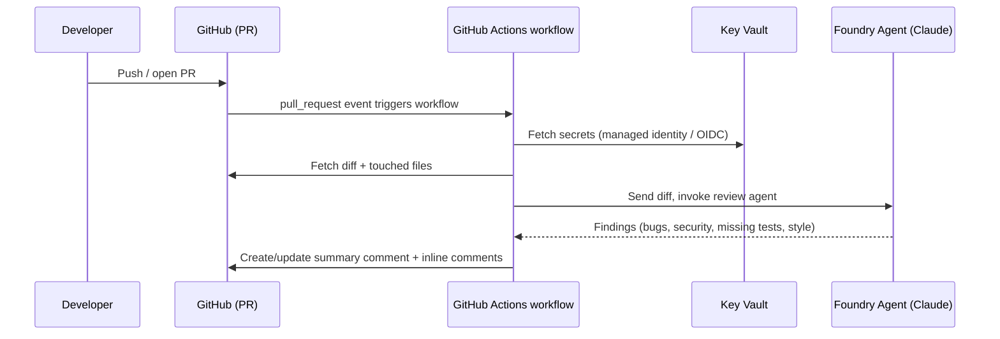

# Architecture

## What this is
An AI agent that reviews every pull request on this repo automatically and posts comments on it. Three moving parts: GitHub (where the PR lives and the trigger fires), a GitHub Actions workflow (the glue), and an Azure AI Foundry Agent Service agent backed by Claude (the actual reviewer).

Claude Code — the CLI used to *build* this repo — is not part of this picture. It's a personal dev tool, not the production reviewer.

## Flow
1. **Developer opens or updates a PR on GitHub.** ([ADR-001](docs/adrs/adr-001-platform.md))
2. **A GitHub Actions workflow, triggered on `pull_request`, calls the Foundry agent directly.** It authenticates to Azure via OIDC (no stored long-lived credential), fetches the diff and touched files from the GitHub API, and sends them to the agent. ([ADR-002](docs/adrs/adr-002-trigger-mechanism.md))
3. **The Foundry agent — Azure AI Foundry Agent Service, configured with a Claude model from the Foundry catalog — reviews the diff** against the MVP's review categories (obvious bugs, security smells, missing tests/null-checks, style) and returns its findings to the workflow. ([ADR-004](docs/adrs/adr-004-agent-hosting.md), [ADR-005](docs/adrs/adr-005-claude-access-path.md))
4. **The workflow posts the findings back on the PR**: one summary comment (overview + severity counts), updated in place on every push, plus inline comments on specific lines for high-confidence findings. Both are re-located via a hidden marker so re-pushing the same PR doesn't spam duplicate comments. ([ADR-003](docs/adrs/adr-003-comment-posting.md))

All secrets (GitHub token for posting comments, anything the Foundry call needs beyond OIDC) come from Azure Key Vault via managed identity — nothing is stored in the repo or the workflow file itself.

## Diagram

## Out of scope for now
Auto-merge/approve, full-repo context beyond the diff + touched files, per-user permissions, multi-platform support. See the MVP scope note in each relevant ADR for why.
